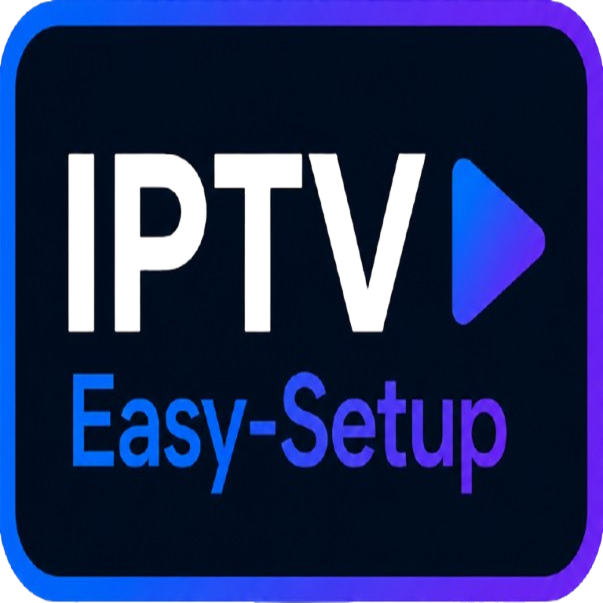
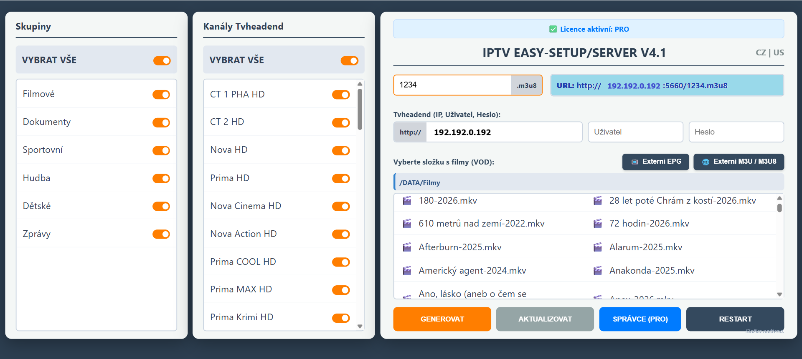
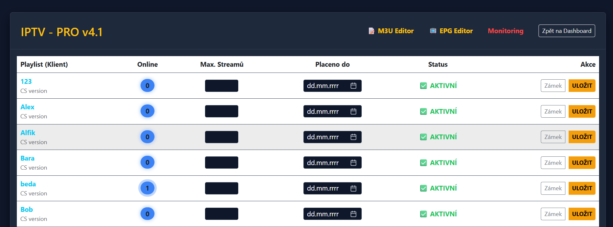
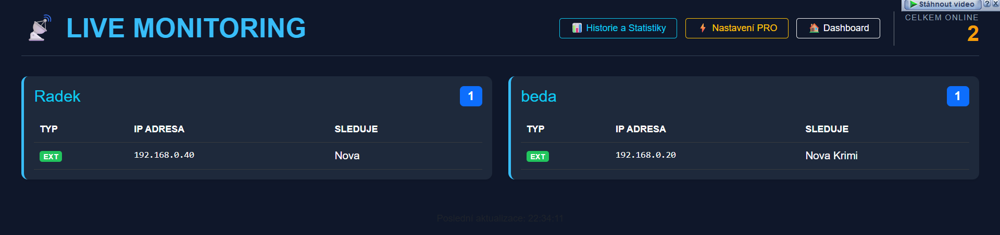
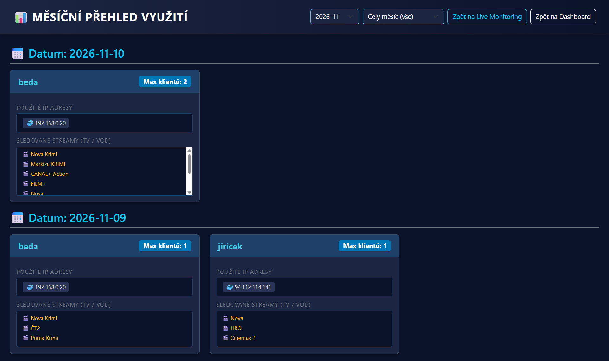
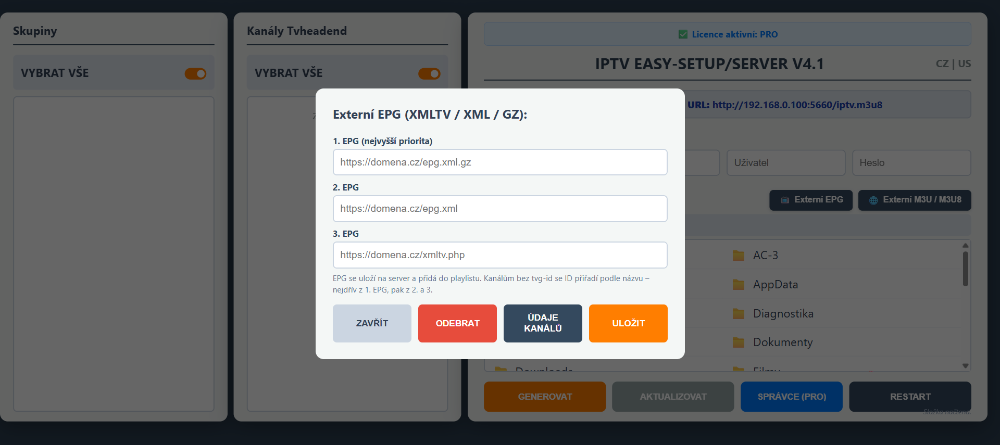
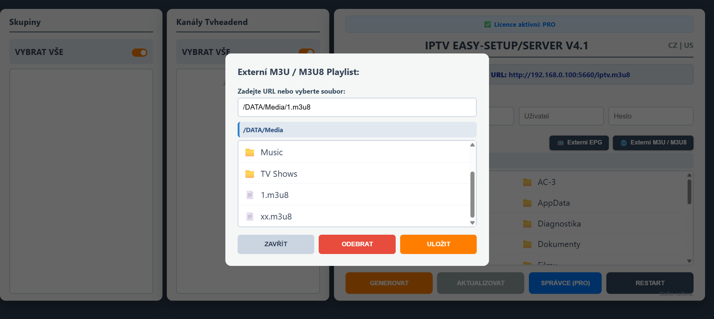
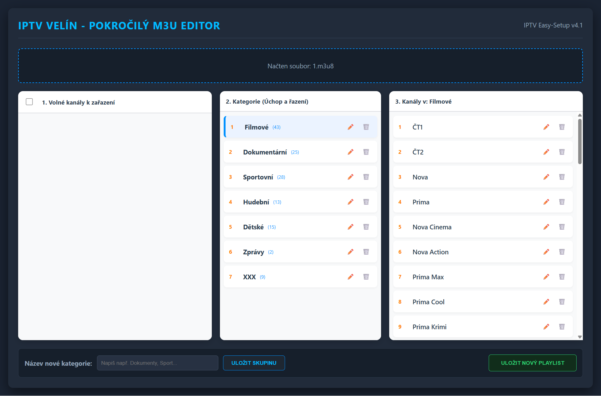
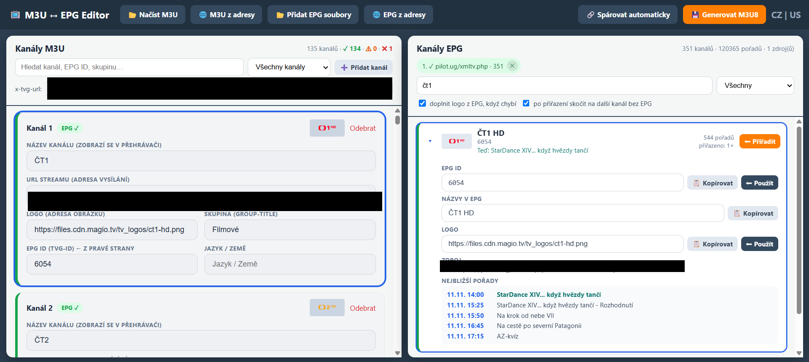

<p align="center">
  
</p>

<h1 align="center">IPTV Easy-Setup</h1>

<p align="center">
  Jednoduchý nástroj pro zprovoznění vlastního IPTV vysílání — lehká náhrada za xTeVe, Threadfin, Plex, Emby či Jellyfin, navržená tak, aby běžela i na slabším hardwaru.
</p>

<p align="center">
  <b><a href="https://iptv-easy-setup.cz">Oficiální stránka programu IPTV Easy-Setup/Server</a></b>
</p>

---

## Co to je

IPTV Easy-Setup/Server propojí tvůj **Tvheadend** s přehrávači a z vybraných kanálů i filmů ti vygeneruje hotový **M3U8 playlist** s vlastní URL. Vše se nastavuje přes přehledné webové rozhraní v prohlížeči — bez editace konfiguráků a bez složitého ladění. Běží v Dockeru, takže instalace je jeden příkaz a funguje i na nenáročném zařízení (NAS, mini PC, Raspberry Pi apod.).

K dispozici je zdarma **10denní plně funkční zkušební verze**, po ní stačí vložit licenční klíč.

## Hlavní funkce

- **Napojení na Tvheadend** — zadáš IP, uživatele a heslo a program si načte dostupné kanály.
- **Výběr kanálů podle skupin** — Filmové, Dokumenty, Sportovní, Hudba, Dětské, Zprávy… zapínáš jednotlivě nebo „Vybrat vše".
- **Generování M3U8 playlistu** s vlastní adresou (`http://IP:5660/playlist.m3u8`), kterou zadáš do libovolného přehrávače.
- **VOD (filmy a seriály)** — vybereš složku s vlastními filmy/seriály a program je přidá do playlistu; ke každému titulu navíc **automaticky doplní plakát a popis z TMDB**.
- **Externí EPG** — až 3 zdroje XMLTV / XML / GZ s prioritou; kanálům bez `tvg-id` přiřadí ID podle názvu.
- **Externí M3U / M3U8** — přidání cizího playlistu přes URL nebo ze souboru.
- **Dvojjazyčné rozhraní** — čeština a angličtina.
- **Licenční ochrana** — 10denní zkušební verze, poté aktivace klíčem; jeden klíč = jedno zařízení.

### Funkce verze PRO

- **Správce klientů** — více playlistů/klientů najednou, limit souběžných streamů, datum „placeno do", zámek a stav u každého.
- **Live Monitoring** — v reálném čase vidíš, kdo je online, z jaké IP a co právě sleduje.
- **Měsíční přehled využití** — historie a statistiky po dnech a klientech (použité IP, sledované streamy).
- **M3U Editor a EPG Editor** — úpravy přímo v rozhraní.

## Náhledy

### Hlavní rozhraní
Výběr skupin a kanálů z Tvheadendu, napojení serveru, VOD a generování playlistu.



### Správce klientů (PRO)
Správa jednotlivých klientů — počet online, limit streamů, platnost a zámek.



### Live Monitoring (PRO)
Kdo je právě online a co sleduje.



### Měsíční přehled využití (PRO)
Historie a statistiky po dnech a klientech.



### Externí EPG
Až tři EPG zdroje (XMLTV / XML / GZ) s prioritou.



### Externí M3U / M3U8
Přidání cizího playlistu přes URL nebo ze souboru.



### M3U Editor (PRO)
Pokročilý editor playlistů — kanály přetahuješ mezi kategoriemi, řadíš je, přejmenováváš a vytváříš vlastní skupiny; výsledek uložíš jako nový playlist.



### M3U ↔ EPG Editor (PRO)
Spáruje kanály z playlistu s EPG — automaticky i ručně. U každého kanálu doplníš EPG ID, logo, skupinu i jazyk a hned vidíš náhled nejbližších pořadů; výstupem je synchronizovaný M3U8.



## Podporované platformy

Obraz je **multi-arch (amd64 + arm64)**, takže běží nativně na většině zařízení:

**Hardware**
- AMD64 (x86-64)
- ARM64
- Raspberry Pi
- Apple Silicon

**Systémy**
- Linux
- NAS (QNAP, Synology)
- macOS (Docker Desktop)
- Windows (Docker Desktop)

**Kontejnery**
- Docker
- Docker Compose

## Instalace

### Linux / NAS

Na Linuxu s připojením k internetu stačí jeden příkaz — doinstaluje Docker (pokud chybí), stáhne hotový obraz a spustí program:

```bash
curl -sSL https://raw.githubusercontent.com/iptv-easy/IPTV-Easy-Setup/main/install.sh | bash
```

Nebo přes Docker Compose:

```bash
curl -sSL https://raw.githubusercontent.com/iptv-easy/IPTV-Easy-Setup/main/docker-compose.yml -o docker-compose.yml
APP_LANG=CZ docker compose up -d
```

### Windows a macOS

Nejdřív si nainstaluj **Docker Desktop** (nebo **Podman**) — na rozdíl od Linuxu si ho program sám nedoplní. Potom spusť připravený launcher, který načte hardwarové ID počítače (kvůli navázání licence) a program spustí:

**Windows** (PowerShell):

```powershell
irm https://raw.githubusercontent.com/iptv-easy/IPTV-Easy-Setup/main/spustit-windows.ps1 | iex
```

**macOS** (Terminál):

```bash
curl -sSL https://raw.githubusercontent.com/iptv-easy/IPTV-Easy-Setup/main/spustit-mac.command | bash
```

Jazyk rozhraní (`CZ` / `EN`) přepneš v launcheru proměnnou `APP_LANG`.

Po instalaci otevři webové rozhraní na:

```
http://IP-ADRESA-SERVERU:5660
```

Aktualizace na novou verzi:

```bash
curl -sSL https://raw.githubusercontent.com/iptv-easy/IPTV-Easy-Setup/main/install.sh | bash
```

## Odinstalace

Zastaví a odstraní program i stažený obraz. Data ve složce `/DATA` (nastavení, playlisty, licence) ve výchozím stavu zůstanou — skript se na jejich smazání zeptá:

```bash
curl -sSL https://raw.githubusercontent.com/iptv-easy/IPTV-Easy-Setup/main/uninstall.sh | bash
```

## Licence a ceny

- **Zkušební verze:** 10 dní zdarma, plně funkční.
- **Standard:** 350 Kč
- **PRO:** 990 Kč

Licence platí 2 roky. Jeden klíč lze používat na jednom zařízení.

## Požadavky

- **Docker** — na Linuxu ho instalátor doplní sám; na Windows/macOS je potřeba mít předem nainstalovaný Docker Desktop (nebo Podman)
- volný port **5660**
- běžící **Tvheadend** jako zdroj živého TV vysílání

## Podpora

Dotazy a hlášení chyb: [iptv-easy-setup.cz](https://iptv-easy-setup.cz)
